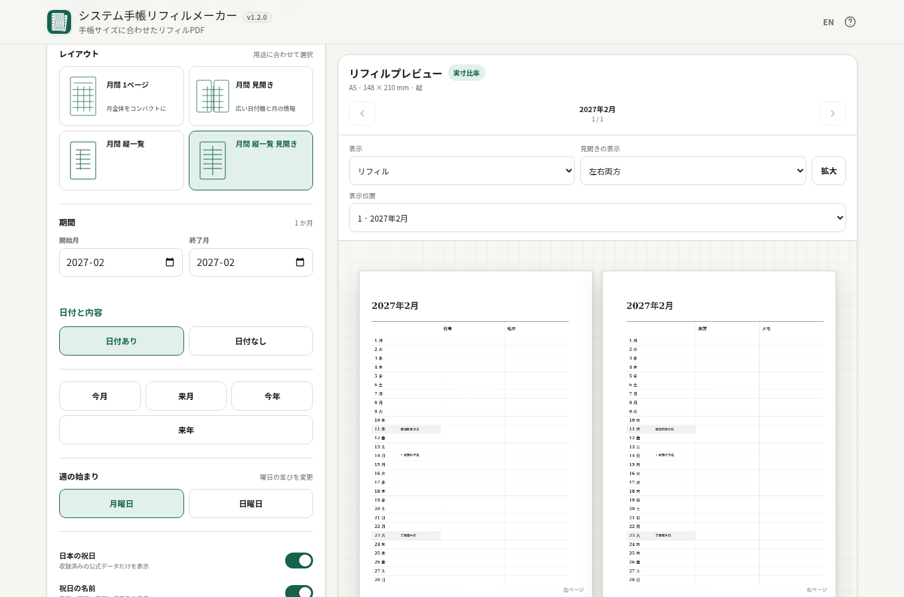

# システム手帳リフィルメーカー / Planner Refill Maker

[](https://github.com/ttomohisa/htmlapps-planner-refill-maker/actions/workflows/deploy-pages.yml)
[](LICENSE)
[](https://ttomohisa.github.io/htmlapps-planner-refill-maker/)

[English README](README.md)

A5・バイブル・ミニ6・Micro5・HB×WA5・Davinci Pocket・カスタムサイズのシステム手帳リフィルを作る単一HTMLアプリです。日付入り・日付なしのリフィルやメモ用紙をブラウザー内で生成し、設定や生成内容を外部サーバーへ送らず、実寸PDFまたはA4 / US Letterへの面付けPDFとして保存できます。

## 🚀 デモ

### [GitHub Pagesでシステム手帳リフィルメーカーを開く](https://ttomohisa.github.io/htmlapps-planner-refill-maker/)

GitHub Pagesから最初のHTMLを読み込んだ後、カレンダー生成・プレビュー・面付け計算・PDF生成は端末内で処理されます。

[](https://ttomohisa.github.io/htmlapps-planner-refill-maker/)

[英語版の画面](assets/screenshot-en.png) · [スマートフォンの画面](assets/screenshot-mobile.png)

## 主な機能

- 入力欄が空欄・無効の間は最後の有効なプレビューを表示し、修正するまでPDFの作成・保存を停止します。メモ用紙のプレビューはPDFと同じ実寸間隔で描画します。

- **実際の手帳サイズで作成** — A5、バイブル、ミニ6、Davinci Pocket、Micro5、HB×WA5、縦 / 横、カスタム寸法に対応します。
- **月間・年間・週間・日間・メモ・用途別** — 月間1ページ / 見開き、年間1ページ / 見開き、週間ブロック / 週間+メモ / バーチカル、1日1ページ、横罫・方眼・ドットを作成できます。
- **用途別リフィル** — 習慣トラッカー（日ごとのチェック欄）、支出管理（日付・内容・費目・金額・合計）、読書ログ（書名・読了日・感想）、週間レビュー（できたこと・課題・来週の予定・メモ）を追加。日付や金額を入力せず、1〜100枚の記入用紙を印刷できます。
- **必要な日だけ作成** — 週間・日間は日単位で期間を指定でき、期間のショートカットや日間の曜日選択も利用できます。週間と日間の期間は別々に記憶します。
- **日付なしリフィル** — 月間・週間・日間を、日付欄が空白の状態で1〜100単位作成できます。見開きは1単位でリフィル2ページです。
- **見開きを前提にした月間レイアウト** — 左右ページの日セルを同じ大きさにし、左ページに月・年と先月 / 来月のミニカレンダーを配置します。
- **日本の祝日** — 2026年・2027年の確認済みデータを内包し、土曜・日曜・祝日の色を個別指定、祝日名の表示も切り替えられます。
- **印刷向けの見た目調整** — Minimal / Classic / 余白狭め、モノクロ / アクセント、文字サイズ5段階、罫線、ページ番号、週番号に対応します。
- **リング側を考慮した配置** — 自動 / 手動リング余白、左右ページの反転、最初のページ指定、パンチ位置の目安を利用できます。
- **実寸PDF・面付けPDF** — リフィルそのものの実寸PDF、またはA4 / US Letterへ縮小せず配置したPDFを保存できます。
- **両面印刷と仕上げ** — 片面 / 長辺とじ / 短辺とじ、裁断ガイド、0〜20 mmの用紙端余白に対応します。両面では、綴じた後に見開きが向かい合うよう、必要な空白面を補います。
- **印刷前に仕上がりを確認** — サムネイル付きレイアウト選択、リフィル・印刷用紙・綴じた状態のプレビュー、直接移動、拡大表示、表示中のページ・見開きだけのお試しPDFを利用できます。スマートフォンは「設定・プレビュー・PDF」のタブで切り替えます。
- **サイズ確認PDF** — 100 mm確認線と50 × 50 mmの確認枠に加え、両面の位置合わせ用の目印を利用できます。PDF生成は途中でキャンセルできます。
- **印刷ズレ補正** — 表面の左右・上下と、裏面だけに加える左右・上下の補正量を、それぞれ-10〜+10 mmの範囲で0.1 mm刻みで指定できます。PDFの内容と裁断ガイドをまとめて移動し、印刷用紙プレビューと位置合わせ確認PDFにも反映します。用紙端からはみ出すと警告します。
- **完全ローカル処理の単一HTML** — 日本語 / 英語、PC / スマートフォン、設定のブラウザー内保存に対応し、実行時のAPI・CDN通信を必要としません。

- **設定ファイルの再利用** — 設定をローカルの `.settings.json` に保存し、内容を確認して読み込めます。保存済み設定や読み込むファイルは検証してから使用します。

## 紙面を調整する

「紙面の詳しい設定」では、日間の時間軸・ToDo・メモの表示、見出し、行数を調整できます。週間ブロックの補助欄はメモ・ToDo・空白から選べます。週間＋メモのメモ面は横罫・方眼・ドット・無地に変更できます。

- **週間バーチカル**は1ページと見開きから選べます。曜日の幅、60分・30分・時刻なし、下部のToDo・メモを設定できます。
- **罫線間隔**は横罫・方眼・ドットで個別に、3〜12 mmの範囲を0.5 mm刻みで指定できます。メモ用紙と同じ種類のメモ欄に反映します。
- **月間 縦一覧**は1日1行です。1〜4列に名前を付けられ、見開きの左右で日付行が揃います。日付なしでは1〜31の番号を印刷します。
- **自分の休日・記念日**は特定日、毎週、毎年の条件で登録できます。年間は印だけを表示し、小さい紙面では名称を省略する場合があります。設定JSONにはこの登録内容も含まれます。以前の設定JSONも読み込めます。

## すぐに使う

### Webで使う

[GitHub Pages版を開く](https://ttomohisa.github.io/htmlapps-planner-refill-maker/)だけで利用できます。アカウント登録やインストールは不要です。

### 単一HTMLをダウンロードして使う

1. このリポジトリの `dist/index.html` をダウンロードします。
2. 現行のChrome / Edge / Firefox / Safariで開きます。
3. 手帳サイズとレイアウトを選び、PDFを作成します。

`dist/index.html` は `file://` から直接開ける構成です。

## 使い方

1. 使用するシステム手帳の実寸サイズと縦 / 横を選びます。
2. 月間 / 年間 / 週間 / 日間 / メモ / 用途別を選び、レイアウトを指定します。
3. 月間・年間は月単位、週間・日間は日単位で期間を設定します。週間は期間にかかる週を丸ごと作成し、日間は全曜日・平日・任意の曜日から選べます。月間・週間・日間で日付を手書きしたい場合は「日付なし」と単位数を選びます。メモと用途別はそれぞれ1〜100枚の枚数を指定できます。週間バーチカルと日間では時間帯も指定できます。
4. 月曜始まり / 日曜始まりを選び、必要なら月間の前後月日付を表示します。
5. 必要に応じて日本の祝日を有効にし、「見た目」で休日色・スタイル・文字サイズ・罫線・ページ番号・週番号を調整します。
6. リング側余白は自動のまま使うか、4〜30 mmで手動指定します。1ページ系では最初のページを右 / 左から選べます。
7. リフィルのプレビューを確認します。月・週・日・ページへ直接移動したり、拡大したりできます。スマートフォンでは **設定 / プレビュー / PDF** のタブで画面を切り替えます。
8. 出力用紙を **リフィル実寸 / A4 / US Letter** から選びます。A4 / Letterではリフィルを縮小せず、用紙向きと配置数を自動計算します。プリンターに合わせて用紙端余白も指定します。
9. 片面 / 長辺とじ / 短辺とじを選び、必要なら裁断ガイドを有効にします。「印刷用紙」と、両面の場合は「綴じた状態」でも確認できます。左ページから始まる見開きでは先頭の表面を空白にし、必要に応じて最後の裏面も空白にします。
10. 表示中のページ・見開きをお試しPDFにするか、全体のPDFを作成して端末へ保存します。生成中はキャンセルできます。

印刷時は **100% / 実際のサイズ** を選び、「用紙に合わせる」は使用しないでください。
印刷位置がずれる場合は「PDF出力」の **印刷位置を補正** を開き、まず表面の左右・上下を調整してください。プラスはPDFの右・下方向です。両面印刷を選ぶと、表面の値に加算する裏面だけの補正も指定できます。「サイズ確認PDF」では100 mm確認線は固定したまま、リフィル外形と両面位置合わせマークに補正が反映されます。大量印刷前に試し刷りしてください。プリンターの拡大縮小や給紙精度を自動補正するものではありません。

用紙端余白の初期値は **0 mm** で、従来の最大配置数を保ちます。用紙の端に近い裁断ガイドはプリンターによって欠ける場合があります。例えばA4にA5を配置すると、余白0 mmでは1面に2枚、5 mmでは1枚になり、リフィル自体は縮小しません。まとめて印刷する前に、お試しPDFやサイズ・位置合わせの確認PDFを印刷し、プリンターのとじ方向も合わせてください。

使い方・確認ダイアログを開いている間は背景のスクロールが止まります。画面の高さが低い場合も、ダイアログ内をスクロールして最後まで確認できます。

パソコンでは「使い方と注意事項」の下部から **ビルド情報** を確認できます。スマートフォンではビルド情報とフッターを表示しません。

### 設定を再利用する

「見た目」内の **設定を保存（.settings.json）** を押すと、編集可能なPDFファイル名をもとに設定JSONを保存します。期間・枚数を含む設定だけを保存し、PDF本体や言語設定は含めません。有効な入力欄に空欄・エラーがある場合は先に修正してください。

**設定を読み込む（JSON）** で64 KiB以下の対応ファイルを選び、サイズ・レイアウト・期間／枚数を確認して置き換えます。キャンセルすると現在の設定とPDFを保持します。置き換え後はPDFを作り直してください。ファイルと設定はブラウザー内だけで処理します。

以前のバージョンで保存した設定ファイルも読み込めます。
設定JSONの形式はv5となり、用途別リフィルの種類と枚数、印刷位置の補正値4項目を保存します。v1〜v4の設定ファイルも読み込め、補正値のない古いファイルは0 mmとして扱います。週間・日間の旧設定は、開始月の1日から終了月の末日までの期間を引き継ぎます。新しい設定ファイルには、日単位の期間・曜日・日付なしの単位数・用紙端余白も保存します。

ブラウザーの保存済み設定が読めない場合は初期設定を表示し、元のデータを保持します。自動保存は設定ファイルの読み込み確定かリセットまで停止します。保存領域を利用できない場合、変更は次回に残らない可能性があるため、設定JSONを保存してください。

## GitHub Pagesで公開する

このリポジトリにはGitHub Pages用のワークフローが含まれています。

1. リポジトリ名を `htmlapps-planner-refill-maker` としてGitHubへプッシュします。
2. **Settings → Pages → Build and deployment → Source** で **GitHub Actions** を選択します。
3. `main` へプッシュするか、ActionsからPagesワークフローを手動実行します。
4. `https://ttomohisa.github.io/htmlapps-planner-refill-maker/` で公開されます。

## 開発とビルド

```text
.
├─ src/index.template.html       # アプリ本体テンプレート
├─ app.config.json               # アプリ情報・ビルド設定
├─ assets/
│  ├─ favicon.svg
│  ├─ screenshot.png
│  ├─ screenshot-en.png
│  └─ screenshot-mobile.png
├─ tests/                        # 回帰・契約テスト
├─ scripts/                      # リポジトリ検査・ビルド補助
├─ build-standalone.bat          # Windows用ビルド入口
├─ build-standalone.ps1          # 単一HTML生成
└─ dist/
   ├─ index.html
   └─ index.self-extract.html
```

WindowsではPowerShellとNode.js 22以降（回帰テスト用）でビルドします:

```powershell
.\build-standalone.bat
```

リポジトリチェック:

```powershell
powershell.exe -NoLogo -NoProfile -ExecutionPolicy Bypass -File .\scripts\check-repository.ps1
```

`dist/` の生成済みHTMLは直接編集しません。

## GitHub Releaseの公開

リリース用PRをマージしたら、**Actions → Publish release → Run workflow** を開きます。ブランチは **main**、バージョンは `app.config.json` と同じ値を `v` なしで入力します（今回は `1.4.0`）。

選択したコミットのビルド・検査後に `v1.4.0` タグを作成し、CHANGELOGの該当バージョンの説明と、次の3ファイルを添付したGitHub Releaseを公開します。

- `planner-refill-maker-v1.4.0.html`：通常の単一HTML版。
- `planner-refill-maker-v1.4.0.self-extract.html`：gzip圧縮した自己展開HTML版。
- `SHA256SUMS.txt`：上記2ファイルのSHA-256チェックサム。

PRの更新やマージだけでは自動公開しません。バージョン不一致、main以外のブランチ、既存タグがある場合は停止します。添付や公開に失敗した場合は、確認用の下書きReleaseが残ることがあります。既存Releaseは上書きしません。検査済みのファイルはActionsの成果物にも保存します。タグ・Releaseの作成権限があるアカウントで実行してください。

## プライバシーと通信防止

手帳設定、カレンダー生成、プレビュー描画、PDF生成はブラウザー内で処理します。

生成HTMLには `connect-src 'none'` を含むContent Security Policyを設定しています。実行時のAPIやCDNを必要としません。次回も使う設定はブラウザーのローカルストレージに保存します。

GitHub Pages版では最初のHTMLを取得する通信は発生します。ネットワークを切った状態で使う場合は `dist/index.html` をローカルで開いてください。

## 制限事項

- 用途別リフィルは**印刷して手書きするための空欄用紙**です。入力した支出・習慣などをアプリで管理する機能ではありません。習慣トラッカーは紙のサイズに応じて日数と習慣列数を調整し（1ページ最大31日）、その他の記入行数もサイズに応じて変わります。

- 日本の祝日データは **2026年・2027年のみ**内包しています。週全体や前後月のセルに実際に表示される日付も収録範囲の確認対象です。未収録年を推測して祝日表示することはありません。日付なしでは祝日を表示しません。
- パンチ位置は位置合わせの目安であり、各手帳メーカーの正確な穴位置を保証するものではありません。
- 印刷ズレ補正によってPDFの用紙外にはみ出すと、リフィルや裁断ガイドの端が欠けます。特に実寸出力や用紙余白が少ない場合は、試し刷りで確認し、余白や補正量を調整してください。
- 日付入力は1900年1月〜2100年12月、選択期間は最大60か月です。
- 日付なしは月間・週間・日間に対応し、1回に1〜100単位を作成できます。年間は日付入りです。
- 長い期間のPDF生成や、メモリの少ないスマートフォンでは処理負荷が高くなる場合があります。
- A4 / US Letter面付けでは、収まらないリフィルを自動縮小しません。実寸で入らない場合はエラーを表示します。
- 正しい実寸で印刷するには、プリンター側を **100% / 実際のサイズ** に設定する必要があります。給紙方向・印刷できない余白・表裏の位置ずれはプリンターによって異なり、位置合わせ用の目印は自動補正を行うものではありません。

## 使用ライブラリ

実行時に外部ライブラリを読み込む構成ではありません。PDF生成とレイアウト処理は単一HTMLに含まれます。詳細は [THIRD_PARTY_NOTICES.md](THIRD_PARTY_NOTICES.md) を確認してください。

## コントリビューション

バグ報告や機能提案はGitHub Issuesからお願いします。開発への参加方法は [CONTRIBUTING.md](CONTRIBUTING.md) を確認してください。

## ライセンス

Copyright © 2026 ttomohisa

このプロジェクトは [MIT License](LICENSE) で公開されています。
