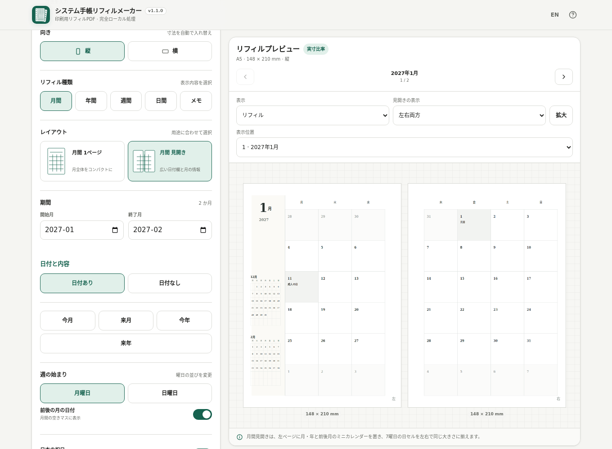

# Planner Refill Maker / システム手帳リフィルメーカー

[](https://github.com/ttomohisa/htmlapps-planner-refill-maker/actions/workflows/deploy-pages.yml)
[](LICENSE)
[](https://ttomohisa.github.io/htmlapps-planner-refill-maker/)

[日本語版 README](README.ja.md)

A single-HTML planner refill generator for A5, Bible, Mini 6, Micro5, HB×WA5, Davinci Pocket, and custom sizes. It creates dated, undated, and note-paper layouts in the browser and exports exact-size or imposed PDFs without sending planner settings or generated content to an external server.

## 🚀 Live demo

### [Open Planner Refill Maker on GitHub Pages](https://ttomohisa.github.io/htmlapps-planner-refill-maker/)

GitHub Pages delivers the initial HTML. After it loads, calendar generation, previews, layout calculation, and PDF creation are processed locally on your device.

[](https://ttomohisa.github.io/htmlapps-planner-refill-maker/)

[English screenshot](assets/screenshot-en.png) · [Phone screenshot](assets/screenshot-mobile.png)

## Features

- Empty or invalid active inputs keep the last valid preview visible, but block PDF creation and saving until corrected. Note-paper previews use the same physical spacing as exported PDFs.

- **Planner sizes that match real paper** — A5, Bible, Mini 6, Davinci Pocket, Micro5, HB×WA5, portrait / landscape, and custom dimensions.
- **Monthly, yearly, weekly, daily, and notes** — Monthly one-page / spread, yearly one-page / spread, weekly block / weekly + notes / vertical, daily, ruled, grid, and dot-grid refills.
- **Choose only the dates you need** — Day-level ranges for weekly and daily refills, period shortcuts, and daily weekday selection. Weekly and daily ranges are remembered separately.
- **Undated refills** — Create 1–100 monthly, weekly, or daily units with blank date fields. A spread counts as one unit and produces two refill pages.
- **Monthly spread built for facing pages** — Equal-size day cells across both pages, with month/year and previous/next mini calendars on the left page.
- **Japanese holiday support** — Bundled verified 2026–2027 holiday data, separate Saturday / Sunday / holiday colors, and optional holiday names.
- **Print-focused appearance controls** — Minimal / Classic / Tight Margins, monochrome / accent output, five text-size levels, ruling weight, page numbers, and week numbers.
- **Ring-side layout handling** — Automatic or manual ring margin, mirrored left/right pages, first-page side selection, and optional punch-position guides.
- **Exact-size and imposed PDF export** — Save the refill at its physical dimensions, or place full-size refills on A4 / US Letter without scaling.
- **Duplex and finishing options** — Single-sided / long-edge / short-edge output, crop guides, and a 0–20 mm paper-edge margin. Duplex output adds the blank faces needed to keep left/right spreads facing after binding.
- **Inspect before printing** — Visual layout cards, refill / print-sheet / bound previews, direct navigation, enlarged preview, and a trial PDF of the current page or spread. Phone tabs keep Settings, Preview, and PDF output close at hand.
- **Print-size test PDF** — Includes a 100 mm reference line, 50 × 50 mm box, and duplex alignment references. PDF generation can be cancelled.
- **Local single-HTML operation** — Japanese / English UI, desktop / smartphone layout, local settings persistence, and no runtime API/CDN requests.

- **Reusable settings files** — Save your setup as local `.settings.json`, then review and restore it later. Stored settings and imported files are validated before use.

## Quick start

### Use the web demo

Open the [GitHub Pages demo](https://ttomohisa.github.io/htmlapps-planner-refill-maker/). No account or installation is required.

### Use the single HTML file

1. Download `dist/index.html` from this repository.
2. Open it in a current Chrome, Edge, Firefox, or Safari.
3. Choose a refill size and layout, then create the PDF.

`dist/index.html` is designed to work directly from `file://`.

## Usage

1. Choose the physical planner size and portrait / landscape orientation.
2. Select Monthly, Yearly, Weekly, Daily, or Notes, then choose its layout.
3. Set a month range for Monthly / Yearly or a start and end date for Weekly / Daily. Weekly output includes each complete week touching the range. Daily can include all days, weekdays, or your selected weekdays. For Monthly / Weekly / Daily, choose Undated and a unit count when you want blank dates. Notes uses a page count. Weekly Vertical and Daily also let you set the time range.
4. Choose Monday / Sunday week start and optionally show adjacent-month dates.
5. Enable bundled Japanese holidays if needed. Adjust colors, style, text size, rules, page numbers, or week numbers under **Appearance**.
6. Keep the automatic ring-side margin or set a manual 4–30 mm margin. For one-page layouts, choose the first page side.
7. Inspect the refill preview, jump directly to a month/week/day/page, or enlarge it. On phones, use the **Settings / Preview / PDF** tabs to move between sections.
8. Choose **Exact refill size**, **A4**, or **US Letter**. A4 / Letter keeps the refill at full physical size and automatically selects paper orientation / placement. Set the paper-edge margin to suit your printer.
9. Choose Single-sided, Long-edge flip, or Short-edge flip, and enable crop guides when needed. Inspect print sheets and, for duplex output, the bound-page view. A left-first spread begins with a blank front so its two pages face each other after binding; a final blank back is added when needed.
10. Export the current page/spread as a trial, or create the full PDF and save it locally. You can cancel a generation in progress.

When printing, choose **100% / Actual size** and do not use **Fit to page**.

The default paper-edge margin is **0 mm**, preserving the existing maximum-fit layout. Crop guides near the paper edge may be clipped by a printer. For example, two A5 refills fit on A4 with 0 mm margin, while a 5 mm margin allows one A5 refill per side; the refill itself is never shrunk. Print a trial or the size/alignment test before a large batch, and match the printer's flip-edge setting to the PDF.

Help and confirmation dialogs pause background scrolling while open. Scroll inside the dialog to reach all content, including on short screens.

### Reuse a setup

Under **Appearance**, choose **Save settings (.settings.json)**. The download uses the editable PDF filename stem; it contains configuration, including period/page count, and no PDF or language preference. Correct invalid active inputs first.

Choose **Load settings (JSON)**, select a supported file up to **64 KiB**, review its size, layout, and period/page count, and confirm replacement. Cancel keeps the current setup and PDF. After replacement, create the PDF again. Settings and files stay in your browser.

Settings saved by earlier versions remain readable. Their weekly/daily month ranges expand to the same first and last calendar dates; new files also remember day ranges, weekday choices, undated counts, and paper-edge margin.

If saved browser settings cannot be read, the app shows defaults and preserves the original record. Automatic saving stays paused until a confirmed import or reset. If storage is unavailable, settings may work only for this session; save a JSON file to keep them.

## Publish with GitHub Pages

The repository includes a GitHub Pages workflow.

1. Push the repository to GitHub as `htmlapps-planner-refill-maker`.
2. Open **Settings → Pages → Build and deployment → Source** and select **GitHub Actions**.
3. Push to `main`, or run the Pages workflow manually from Actions.
4. The app is then available at `https://ttomohisa.github.io/htmlapps-planner-refill-maker/`.

## Development and build layout

```text
.
├─ src/index.template.html       # Application template
├─ app.config.json               # App metadata and build settings
├─ assets/
│  ├─ favicon.svg
│  ├─ screenshot.png
│  ├─ screenshot-en.png
│  └─ screenshot-mobile.png
├─ tests/                        # Contract / regression tests
├─ scripts/                      # Repository checks and builders
├─ build-standalone.bat          # Windows build entry point
├─ build-standalone.ps1          # Single-HTML builder
└─ dist/
   ├─ index.html
   └─ index.self-extract.html
```

Build on Windows with PowerShell and Node.js 22 or newer (for the regression suite):

```powershell
.\build-standalone.bat
```

Repository checks:

```powershell
powershell.exe -NoLogo -NoProfile -ExecutionPolicy Bypass -File .\scripts\check-repository.ps1
```

Do not edit generated files in `dist/` directly.

## Privacy and runtime network protection

Planner settings, calendar generation, preview rendering, and PDF creation are processed locally in the browser.

The generated app includes a Content Security Policy with `connect-src 'none'`. It does not require a runtime API or CDN. Settings that are remembered are stored in browser local storage.

The GitHub Pages version still requires the initial HTML request. For use with the network disconnected, open `dist/index.html` locally.

## Limitations

- Bundled Japanese holiday data covers **2026 and 2027 only**. Coverage includes dates shown in full weeks and adjacent-month cells; dates outside bundled coverage are intentionally not guessed. Undated refills do not show holidays.
- Punch-position guides are alignment references and do not guarantee a binder manufacturer's exact hole positions.
- Supported date input is January 1900 through December 2100, with a maximum selected range of 60 months.
- Undated generation supports Monthly, Weekly, and Daily; Yearly remains dated. Each request supports 1–100 undated units.
- Very large date ranges, high PDF raster DPI, or constrained mobile devices can require substantial memory during PDF generation.
- A4 / US Letter imposition never silently scales a refill down. If it does not fit at full size, the app shows an error.
- Accurate physical output depends on the printer being set to **100% / Actual size**. Printer feed direction, non-printable margins, and duplex registration vary; alignment marks are checks, not automatic printer calibration.

## Dependencies

Planner Refill Maker has no external runtime dependency. PDF generation and layout logic are included in the single HTML build. See [THIRD_PARTY_NOTICES.md](THIRD_PARTY_NOTICES.md) for repository notices.

## Contributing

Bug reports and feature proposals are welcome through GitHub Issues. See [CONTRIBUTING.md](CONTRIBUTING.md) for development guidance.

## License

Copyright © 2026 ttomohisa

Licensed under the [MIT License](LICENSE).
